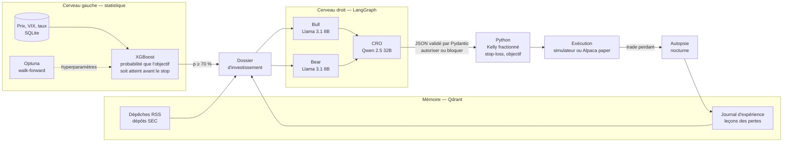

# AI Hedge Fund — étude d'une architecture neuro-symbolique pour la décision sous risque

Un modèle statistique propose des trades, un comité de LLM locaux a le droit de les bloquer,
et du code Python déterministe garde seul la main sur l'argent.

Ce dépôt est un **projet de recherche et d'apprentissage**. Il ne passe aucun ordre réel, ne promet
aucune performance, et sa conclusion provisoire est honnête : sur la période testée, le signal ne bat
pas le marché. L'intérêt est dans la méthode — comment construire un tel système sans qu'il triche,
et comment mesurer ce que les LLM y apportent vraiment.

## La question posée

Un LLM qui lit l'actualité peut-il améliorer un signal quantitatif en lui opposant un veto ?
Et surtout : comment le savoir, sachant que bloquer des trades au hasard change aussi les résultats ?

## Architecture



Trois règles tiennent l'ensemble :

1. **Le LLM ne peut que bloquer.** Sa sortie est un objet `VetoDecision` strict (`extra="forbid"`,
   validateurs de cohérence). Il ne choisit ni la valeur, ni la taille, ni le stop. Il ne peut pas
   créer un ordre que XGBoost n'a pas émis.
2. **En cas de doute, on ne trade pas.** Modèle éteint, JSON invalide après trois relances, délai
   dépassé : le verdict devient un veto de sécurité.
3. **Rien ne regarde le futur.** Features, cibles, dépêches et leçons sont filtrées par date ; le
   modèle n'est entraîné que sur des trades dont l'issue était déjà connue.

Tout tourne en local : Ollama et LM Studio pour les modèles, Qdrant pour les vecteurs, SQLite pour les prix.

## Résultats

### Moteur quantitatif seul, année 2023 (hors échantillon)

| | Stratégie | S&P 500 (achat-conservation) |
|---|---|---|
| Rendement | +1,73 % | +26,7 % |
| Ratio de Sharpe | 1,29 | — |
| Perte maximale | −1,29 % | — |
| Trades | 24, dont 75 % gagnants | — |

Lecture : la stratégie est investie une petite fraction du temps (Kelly au quart, dix valeurs), d'où
une courbe presque plate. Le Sharpe est flatteur mais repose sur 24 trades ; l'AUC du classifieur en
validation est proche de 0,5, autrement dit **l'avantage statistique n'est pas démontré**. Les
hyperparamètres ont été choisis par Optuna sur des données antérieures à 2023.

Les chiffres varient légèrement d'un jour à l'autre (un trade de plus ou de moins) parce que Yahoo
recalcule les prix ajustés ; à données identiques, le backtest est déterministe.

### Valeur du veto : l'expérience contrôlée

`run_experiment.py` rejoue la même période dans trois configurations qui partagent exactement les
mêmes modèles XGBoost, donc les mêmes signaux :

| Bras | Politique |
|---|---|
| A | tout signal est exécuté |
| B | débat Bull/Bear puis veto du CRO |
| C | veto tiré au hasard, au même taux que le CRO, répété N fois |

Le bras C est le témoin. Sur 2023, un veto aléatoire à 30 % fait *baisser* le Sharpe (médiane 0,74
sur 30 tirages, intervalle 5 %–95 % de 0,17 à 1,34, contre 1,29 sans veto) : filtrer n'est pas
gratuit. Le CRO n'a de valeur que s'il sort du haut de cette distribution, et si les signaux qu'il
bloque auraient réellement moins rapporté que ceux qu'il autorise (test de permutation).

**État actuel : le bras B n'a pas encore été exécuté avec les modèles prévus** (Llama 3.1 8B et
Qwen 2.5 32B demandent plus de mémoire que la machine de développement). Un essai technique de dix
jours avec un petit modèle a validé la chaîne complète — 5 signaux, 0 JSON rejeté, 1 autopsie — mais
ne dit rien de la qualité des verdicts. Le script refuse de conclure en dessous de cinq signaux par groupe.

### Une réserve qui ne se corrige pas en backtest

Un LLM entraîné après 2023 « connaît » 2023. Lui faire juger un trade de mars 2023 n'est pas un test
propre, même si le dossier qu'on lui fournit est filtré par date. La seule mesure sans ce biais est le
**paper-trading en temps réel** : le tableau de bord recalcule, pour chaque signal bloqué, ce que le
trade serait devenu une fois son issue connue.

## Ce que les tests ont attrapé

Trois défauts trouvés en exécutant réellement le système, typiques de ce genre de projet :

- **Un P/E faux d'un facteur dix** sur NVDA : les prix historiques sont ajustés des divisions
  d'actions, pas les bénéfices par action publiés à l'époque. Corrigé par une table des splits.
- **Un plantage silencieux** quand XGBoost s'entraîne après le chargement de PyTorch sur macOS (deux
  runtimes OpenMP dans le même processus).
- **« Event loop is closed » au deuxième signal** : `asyncio.run` fermait la boucle à laquelle les
  clients HTTP des modèles restaient attachés.

La suite automatisée (84 tests, deux secondes, sans réseau ni LLM) couvre le verrou Pydantic, le
critère de Kelly, l'absence de fuite temporelle, le moteur d'exécution, la chaîne de décision, les
statistiques de l'expérience et le tableau de bord. Les tests anti-fuite ont été vérifiés par
mutation : une moyenne mobile centrée ou une purge retirée les font échouer.

## Installation

```bash
python3.12 -m venv venv && source venv/bin/activate
pip install -r requirements.txt -r requirements-dev.txt
cp .env.example .env
```

Pour le comité IA : [Ollama](https://ollama.com) avec `llama3.1:8b`, et [LM Studio](https://lmstudio.ai)
avec un Qwen 2.5 32B servi en mode serveur. Qdrant est optionnel : sans serveur, une base embarquée
est créée dans `data/qdrant_local`.

## Utilisation

```bash
python -m pytest                                  # tests
python -m data_pipeline.fetch_history             # télécharge prix et indicateurs macro
python -m quant_engine.optimizer                  # recherche d'hyperparamètres (Optuna)
python run_backtest.py --no-llm                   # moteur quantitatif seul, 2023
python run_backtest.py                            # système complet (modèles requis)
python run_experiment.py                          # les trois bras + verdict statistique
python run_experiment.py --veto-rate 0.3          # sans LLM : bras A et C seulement
python dashboard.py --run <identifiant> --open    # page de synthèse d'un backtest
```

### Paper-trading en continu

```bash
python run_live.py --loop --at 16:30    # un cycle par jour ouvré, après la clôture de New York
python run_live.py --status             # état du portefeuille
python dashboard.py --open              # tableau de bord (data/dashboard.html)
```

Chaque cycle met à jour les données, gère les positions, soumet les nouveaux signaux au comité,
autopsie les pertes, puis régénère `data/dashboard.html`. Pour que la boucle survive à la fermeture
du terminal : `tmux`, ou `nohup python run_live.py --loop > live.log 2>&1 &`.

Le broker par défaut est un simulateur local qui partage son moteur d'exécution avec le backtest.
Un connecteur Alpaca (compte papier uniquement) existe mais **n'a pas été testé**.

## Organisation du code

```
data_pipeline/   prix et macro (SQLite), dépêches RSS et dépôts SEC, Qdrant, dossier d'investissement
quant_engine/    features, cibles par barrières, XGBoost, Kelly, optimisation Optuna
llm_agents/      schémas Pydantic, prompts, graphe LangGraph (comité et autopsie)
run_backtest.py  simulation walk-forward et moteur d'exécution
run_experiment.py  expérience contrôlée sur la valeur du veto
run_live.py      cycle quotidien de paper-trading
dashboard.py     tableau de bord HTML
tests/           suite pytest
```

## Limites connues

- **Signal non prouvé** : dix grandes capitalisations, une seule année de test, peu de trades.
- **Biais du survivant** : l'univers est choisi aujourd'hui, avec des valeurs qui ont bien tourné.
- **Dépêches historiques incomplètes** : la recherche datée de Google News ne restitue pas ce qui
  était réellement lisible le jour même.
- **Exécution idéalisée** : remplissage à l'ouverture, coûts forfaitaires de 5 points de base, pas de
  liquidité ni de frais d'emprunt.
- **Contamination des LLM en backtest**, décrite plus haut.
- Données de dark pools et de flux d'options collectées mais pas évaluées dans le modèle.

## Suite prévue

1. Exécuter le bras B de l'expérience avec les modèles cibles.
2. Laisser tourner le paper-trading plusieurs mois et publier la courbe, quelle qu'elle soit.
3. Faire lire au LLM les 8-K et 10-Q en entier pour en extraire des variables chiffrées, et tester si
   elles améliorent le classifieur — le LLM comme source d'information plutôt que comme filtre.

---

*Projet personnel à but éducatif. Rien ici ne constitue un conseil en investissement.*
